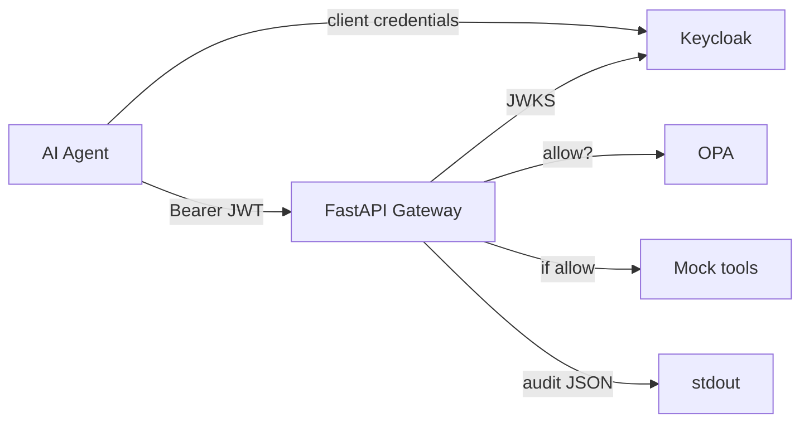
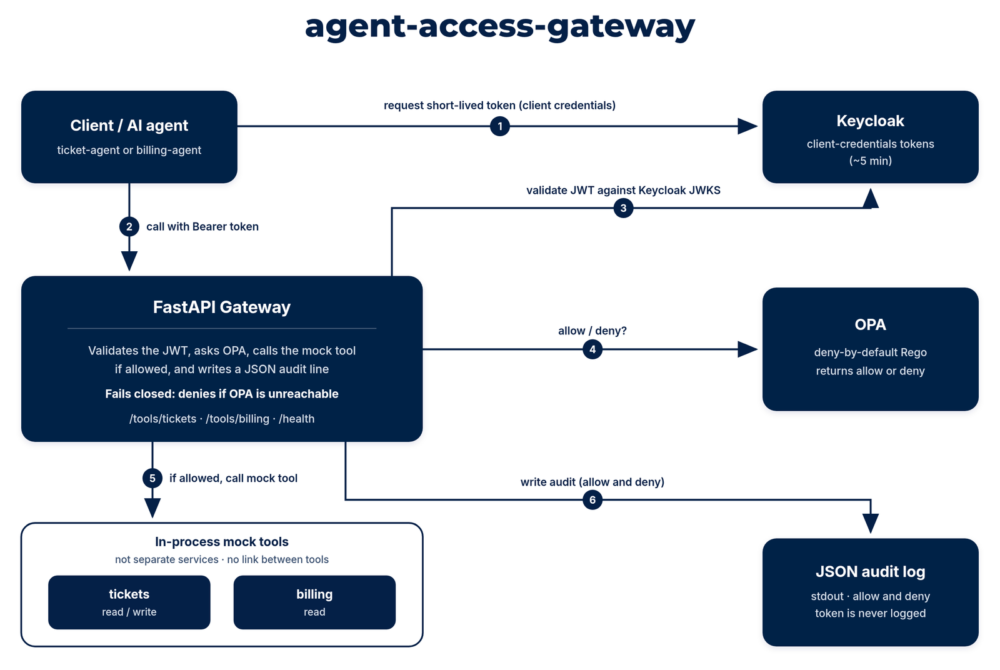

# agent-access-gateway

[](https://github.com/dardan-hoxhaj/agent-access-gateway/actions/workflows/ci.yml?query=branch%3Amain)

Local identity and access gateway for AI agents. Each agent is a Keycloak client using the OAuth2 client-credentials grant. The gateway validates the short-lived JWT, asks OPA for a per-agent / per-tool / per-action decision, and writes a structured audit log. Downstream tools are mocks.

## What this does

- Issues short-lived (~5 min) client-credentials tokens from a local Keycloak.
- Validates JWT signature, issuer, audience, expiry, and algorithm against Keycloak JWKS.
- Asks OPA for an allow/deny. Deny by default. Deny if OPA is unreachable.
- Structured JSON audit line for every allow and deny. The token is never logged.
- Mock tools: tickets read/write, billing read.

## What this does not do

- No real downstream systems. Tools are in-process mocks.
- No AWS deploy. Terraform is validate-only.
- No multi-tenant production IdP. Keycloak runs locally for the demo.
- No token revocation list. Expiry is the only time bound.
- No rate limiting or WAF.

## Architecture





## Quick start

Requires Docker and Docker Compose.

```bash
make up
# wait for Keycloak to finish starting (about a minute)
make demo
make down
```

## Tests

```bash
pip install -r requirements.txt
make test
```

`opa` must be on PATH for the policy tests. Install from https://www.openpolicyagent.org/docs/latest/#running-opa. CI and Docker Compose pin OPA 0.68.0; the policies also pass `opa test` on OPA 1.x.

## Demo cases

`scripts/demo.sh` shows three calls:

1. `ticket-agent` reads tickets: allowed.
2. `billing-agent` reads tickets: denied.
3. Invalid token: 401.

Client secrets in `keycloak/realm.json` are demo-only. Do not reuse them anywhere.

## What broke and how I fixed it

- **Every demo call returned 401.** The token's `iss` claim was `http://localhost:8080/...` because the demo script talks to Keycloak through localhost. The gateway runs in Docker and reaches Keycloak at `http://keycloak:8080`, and it used that same URL as the expected issuer, so the issuer check failed even though the signature was fine. Fix: split the setting into `KEYCLOAK_URL` (where to fetch signing keys) and `ISSUER` (what the token says). Details in [docs/LEARNING-PATH.md](docs/LEARNING-PATH.md#issuer-vs-keycloak_url).
- **Trivy failed the image build.** HIGH/CRITICAL CVEs in `python-jose` and `fastapi`, plus `zlib` in the base image. Fix: bumped `python-jose` 3.3.0 to 3.5.0 and `fastapi`, and upgraded `zlib1g` in the Dockerfile.
- **Audit lines never showed up.** Uvicorn leaves non-uvicorn loggers at WARNING, so the INFO audit lines were dropped. Fix: give the `gateway.audit` logger its own INFO handler on stdout, with a test that checks the line is written.
- **`opa test` failed on OPA 1.x.** CI pinned OPA 0.68, but the README linked to the current OPA, and 1.x requires the `if` keyword. Fix: rewrote the policies with `import rego.v1`, which both versions accept.
- **OIDC trust was too broad.** The AWS role first trusted `repo:<owner>/<repo>:*`, which means any branch or pull request could assume it. Fix: narrowed it to `ref:refs/heads/main`.

## Runbook

[docs/RUNBOOK.md](docs/RUNBOOK.md) covers "an agent gets 403 it should not get" and "every call returns 401", starting from the audit line's `request_id` and `reason`.

## Teardown and cost

Everything runs locally in Docker, so there is no cloud cost. The Terraform is validate-only and creates nothing.

```bash
make down            # docker compose down -v: stops containers, removes volumes
docker compose ps    # should list nothing for this project
```

## Design notes

See [docs/DESIGN.md](docs/DESIGN.md) for the choices and tradeoffs, and [docs/LEARNING-PATH.md](docs/LEARNING-PATH.md) for a rebuild walkthrough.
