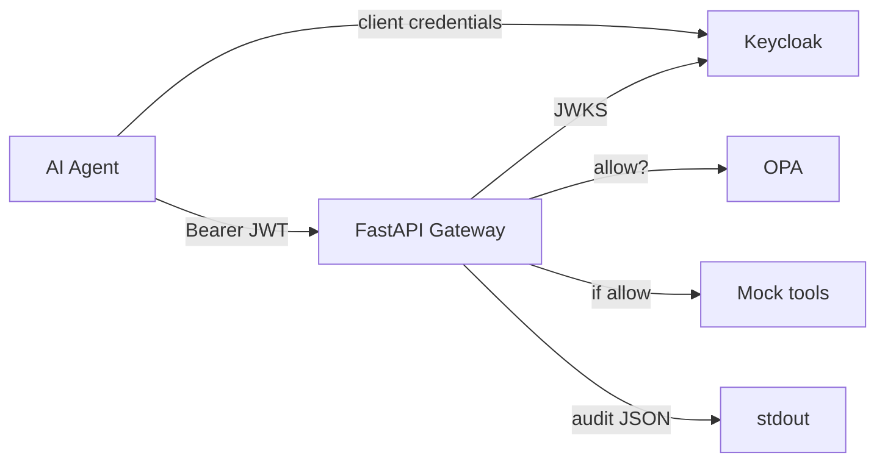

# agent-access-gateway

[](https://github.com/dardan-hoxhaj/agent-access-gateway/actions/workflows/ci.yml?query=branch%3Amain)

Local identity and access gateway for AI agents. Each agent is a Keycloak client using the OAuth2 client-credentials grant. The gateway validates the short-lived JWT, asks OPA for a per-agent / per-tool / per-action decision, and writes a structured audit log. Downstream tools are mocks.

## What this does

- Issues short-lived (~5 min) client-credentials tokens from a local Keycloak.
- Validates JWT signature, issuer, audience, expiry, and algorithm against Keycloak JWKS.
- Asks OPA for an allow/deny. Deny by default. Deny if OPA is unreachable.
- Structured JSON audit line for every allow and deny. The token is never logged.
- Mock tools: tickets read/write, billing read.

## What this does not do

- No real downstream systems. Tools are in-process mocks.
- No AWS deploy. Terraform is validate-only.
- No multi-tenant production IdP. Keycloak runs locally for the demo.
- No token revocation list. Expiry is the only time bound.
- No rate limiting or WAF.

## Architecture




## Quick start

Requires Docker and Docker Compose.

```bash
make up
# wait for Keycloak to finish starting (about a minute)
make demo
make down
```

## Tests

```bash
pip install -r requirements.txt
make test
```

`opa` must be on PATH for the policy tests. Install from https://www.openpolicyagent.org/docs/latest/#running-opa

## Demo cases

`scripts/demo.sh` shows three calls:

1. `ticket-agent` reads tickets: allowed.
2. `billing-agent` reads tickets: denied.
3. Invalid token: 401.

Client secrets in `keycloak/realm.json` are demo-only. Do not reuse them anywhere.

## Design notes

See [docs/DESIGN.md](docs/DESIGN.md) for the choices and tradeoffs, and [docs/LEARNING-PATH.md](docs/LEARNING-PATH.md) for a rebuild walkthrough.
